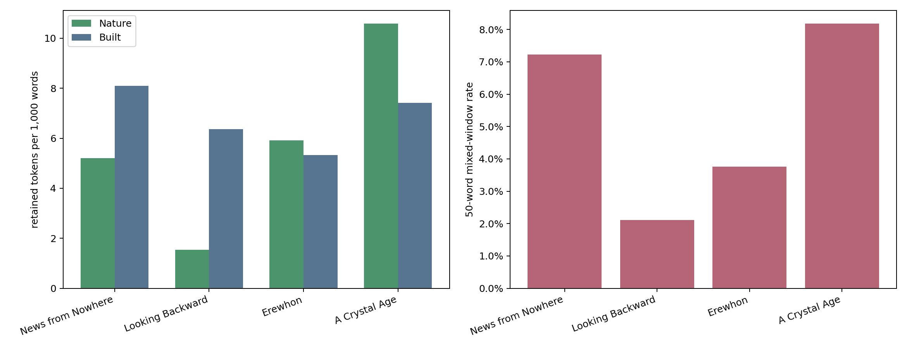

:::: {.section .screen .center .title-slide}
::: kicker
後半：本文の分析を試みる
:::

# 自然物と人工物の語は<br>どこで出会うか

::: lead
Morrisの *News from Nowhere*（1890年連載／1891年刊）を、自然56語・人工60語のリストで同時代のユートピア／ディストピア文学3作品と比較する
:::

::: {.title-axis aria-label="Nature and human-made objects"}
<span class="nature-word">river · tree · meadow</span>
<span class="axis-line"></span>
<span class="built-word">house · street · building</span>
:::

::: byline
Bennett (2026) の「再野生化」読解を手がかりに
:::
::::

:::: {.section .screen .starting-point}
::: kicker
1 — Starting point
:::

## 「再野生化された英国」は、本文にどう現れるか？

::: {.paper-card .paper-card-wide}
<div class="paper-label">GREEN LETTERS: STUDIES IN ECOCRITICISM · 2026</div>
<h3>Wild Belongings</h3>
<p>Stories of Rewilding in William Morris’s <i>News from Nowhere</i> and Diane Setterfield’s <i>Once Upon a River</i></p>
<p class="paper-author">Phillippa Bennett</p>
<a href="https://doi.org/10.1080/14688417.2026.2733353">doi:10.1080/14688417.2026.2733353</a>
:::

::: {.panel .paper-summary}
**論文と本発表の位置づけ**

エコクリティシズムは、文学のなかで人間と自然・環境の関係がどう描かれるかを考える研究で、Bennettの論文はその一例である。

BennettはMorrisの『News from Nowhere』とDiane Setterfieldの『Once Upon a River』を比較し、Thamesを軸に、人間中心の見方を問い直す再野生化の物語と社会・環境正義の可能性を読む。

:::

::: {.thames-comparison}
### 二つの小説をつなぐThames

::: {.two-col .evidence-grid .thames-grid}
::: {.panel .excerpt-card .nature-panel}
**Morris, *News from Nowhere***

<span class="work-year">（1890年連載／1891年刊）</span>

革命後の未来社会を描く。Thamesの旅で、街・家・樹木・野生生物との関係が見直される。
:::

::: {.panel .excerpt-card .built-panel}
**Setterfield, *Once Upon a River***

<span class="work-year">（2018年刊）</span>

19世紀末を描く現代の歴史小説。Thamesは人間の思いどおりにならず、洪水も共同体の物語を動かす。
:::
:::

::: {.verdict}
Bennettは両作に、人間中心の見方の転換、過去とのつながり、正義、物語ることを読む。
:::

::: note
ここはBennett (2026) の比較の要約。Setterfieldの本文全体を用いた語数・共存率の集計ではない。
:::
:::

::: {.bennett-quote}
> “… there is a more organic relationship between the natural and the built environments in Morris’s vision.”

<span>Bennett (2026), p. 6 · 「Morrisの構想では、自然環境と建造環境がより有機的に結びついている」</span>
:::

::: quote
**問い**　自然物と人工物が同じ場面に現れる頻度は、Morrisでとくに高いのか？
:::
::::

:::: {.section .screen}
::: kicker
2 — Four works
:::

## 比較するのは4つの同時代の<br>ユートピア／ディストピア文学

::: {.two-col .corpus-grid}
::: {.panel .work-card .morris-card}
**Morris, *News from Nowhere*** <span>1890 / 1891</span>

Thamesの旅を通して、革命後の英国を描く。Bennettの読解対象。

<nav class="work-links" aria-label="News from Nowhere の資料リンク"><a href="https://openlibrary.org/books/OL24233393M" target="_blank" rel="noopener">Open Library</a><a href="https://www.gutenberg.org/ebooks/3261" target="_blank" rel="noopener">Gutenberg</a><a href="https://www.wikidata.org/wiki/Q7019506" target="_blank" rel="noopener">Wikidata</a></nav>
:::

::: {.panel .work-card}
**Bellamy, *Looking Backward*** <span>1888</span>

Bostonの中央集権的な産業組織と都市制度。

<nav class="work-links" aria-label="Looking Backward の資料リンク"><a href="https://openlibrary.org/books/OL6967789M" target="_blank" rel="noopener">Open Library</a><a href="https://www.gutenberg.org/ebooks/624" target="_blank" rel="noopener">Gutenberg</a><a href="https://www.wikidata.org/wiki/Q1305106" target="_blank" rel="noopener">Wikidata</a></nav>
:::

::: {.panel .work-card}
**Butler, *Erewhon*** <span>1872</span>

機械・制度を反転して問う風刺的作品。

<nav class="work-links" aria-label="Erewhon の資料リンク"><a href="https://openlibrary.org/books/OL23297922M" target="_blank" rel="noopener">Open Library</a><a href="https://www.gutenberg.org/ebooks/1906" target="_blank" rel="noopener">Gutenberg</a><a href="https://www.wikidata.org/wiki/Q1350048" target="_blank" rel="noopener">Wikidata</a></nav>
:::

::: {.panel .work-card}
**Hudson, *A Crystal Age*** <span>1887 / 1919 rev.</span>

田園、共同体、巨大な家と装飾を描く牧歌的ロマンス。

<nav class="work-links" aria-label="A Crystal Age の資料リンク"><a href="https://openlibrary.org/books/OL7151703M" target="_blank" rel="noopener">Open Library</a><a href="https://www.gutenberg.org/ebooks/7401" target="_blank" rel="noopener">Gutenberg</a><a href="https://www.wikidata.org/wiki/Q4656205" target="_blank" rel="noopener">Wikidata</a></nav>
:::
:::

::: note
Open Libraryは参照した所蔵版、Gutenbergは今回の集計本文、Wikidataは作品の項目。リンク先は同一の版を表すとは限らない。
:::
::::

:::: {.section .flow .lexicon-slide}
::: kicker
3 — What we count
:::

## 自然物と人工物の語を、先にリストにする

::: lead
本文で数える116語。自然物56語と人工物60語を、あらかじめ固定する。
:::

<div class="lexicon-grid"><section class="panel lexicon-panel nature-panel"><h3>自然物 · 56語</h3><ul class="lexicon-words"><li>air</li><li>animal</li><li>ash</li><li>bird</li><li>blossom</li><li>bull</li><li>cattle</li><li>chestnut</li><li>cloud</li><li>coal</li><li>cow</li><li>desert</li><li>dog</li><li>duck</li><li>dust</li><li>earth</li><li>flood</li><li>flower</li><li>foliage</li><li>forest</li><li>fruit</li><li>glacier</li><li>goat</li><li>grass</li><li>grove</li><li>horse</li><li>island</li><li>lake</li><li>land</li><li>leaf</li><li>lily</li><li>lion</li><li>meadow</li><li>mist</li><li>moon</li><li>mountain</li><li>oak</li><li>orchard</li><li>rain</li><li>rainbow</li><li>river</li><li>root</li><li>rose</li><li>sea</li><li>sheep</li><li>slope</li><li>snow</li><li>soil</li><li>sun</li><li>tail</li><li>tide</li><li>tree</li><li>valley</li><li>water</li><li>wolf</li><li>wood</li></ul></section><section class="panel lexicon-panel built-panel"><h3>人工物 · 60語</h3><ul class="lexicon-words"><li>apartment</li><li>arcade</li><li>booth</li><li>box</li><li>brick</li><li>bridge</li><li>building</li><li>car</li><li>carriage</li><li>chair</li><li>chamber</li><li>city</li><li>clock</li><li>clothes</li><li>clothing</li><li>door</li><li>dwelling</li><li>engine</li><li>factory</li><li>floor</li><li>furniture</li><li>gallery</li><li>gate</li><li>glass</li><li>gun</li><li>hall</li><li>hospital</li><li>house</li><li>library</li><li>machine</li><li>machinery</li><li>mansion</li><li>newspaper</li><li>paper</li><li>picture</li><li>pillar</li><li>pipe</li><li>platform</li><li>prison</li><li>railway</li><li>roadway</li><li>roof</li><li>room</li><li>seat</li><li>shoe</li><li>shop</li><li>station</li><li>store</li><li>street</li><li>telephone</li><li>tenement</li><li>tower</li><li>train</li><li>tube</li><li>vehicle</li><li>wall</li><li>warehouse</li><li>wheel</li><li>window</li><li>workshop</li></ul></section></div>

::: {.excluded-words}
**入れなかった語の例**

<span>family</span><span>company</span><span>morning</span><span>work</span><span>system</span><span>business</span><span>service</span><span>power</span><span>bank</span><span>hand</span>
:::

::: note
社会集団・制度・時間・抽象概念、多義的な語は、物理的な自然物・人工物のリストに含めない。
:::
::::

:::: {.section .screen .window-example-slide}
::: kicker
4 — Local co-occurrence
:::

## 50語の範囲で、両方が現れるか？

::: lead
章をまたがない50語窓を25語ずつ動かす。自然物と人工物が両方あれば「共存」1件。
:::

<div class="window-steps" aria-label="50語窓を25語ずつ動かす図"><div class="step-ranges"><span>1–25語</span><span>26–50語</span><span>51–75語</span></div><div class="step-window first">窓A：1–50語</div><div class="step-window second">窓B：26–75語</div></div>

::: {.panel .window-example}
**実例：Morris『News from Nowhere』第10章より**

> “Beyond that the houses are scattered wide about the meadows there … the lovely river Lea”

<div class="window-hits"><span class="built-hit">7語目 houses → house〈人工物〉</span><span class="nature-hit">13語目 meadows → meadow〈自然物〉</span><span class="nature-hit">27語目 river〈自然物〉</span></div>
:::

::: {.verdict}
この50語には両方あるので「共存」。語の近さや物語での関係は、続けて本文を読む。
:::
::::

:::: {.section .screen}
::: kicker
5 — Four-work result
:::

## 今回のリストではHudsonが最も高い

::: lead
50語窓の共存率：Hudson 8.18%、Morris 7.22%。差は0.96ポイント。
:::



::: {.result-strip}
<span class="focus"><b>7.22%</b><small>News from Nowhere</small></span>
<span><b>8.18%</b><small>A Crystal Age</small></span>
<span><b>3.76%</b><small>Erewhon</small></span>
<span><b>2.11%</b><small>Looking Backward</small></span>
:::

::: note
OCR誤読による語の抽出ミスを減らすためGutenberg版を利用。Open Libraryから辿れるInternet Archive版OCRを742箇所修正して比べても、共存率差は最大0.2ポイントで作品順位は同じ（版差も含む）。
:::
::::

:::: {.section .screen}
::: kicker
6 — Within Morris
:::

## 制度の説明では少なく、街と川の旅で現れる

::: {.phase-grid}
::: panel
**Londonでの遭遇**<br>
第1–10章

<b>9.5%</b><small>100 / 1,050窓</small>
:::

::: panel
**制度説明・革命史**<br>
第11–18章

<b>0.8%</b><small>7 / 854窓</small>
:::

::: {.panel .focus-phase}
**Thames航行・帰還**<br>
第19–32章

<b>9.9%</b><small>113 / 1,143窓</small>
:::
:::

::: {.two-col .chapter-findings}
::: panel
**第10章：Aldgateの先**

`meadow · river` × `house · street`。家と草地、River Leaが同じ記述に入る。
:::

::: panel
**第30章：旅の終わり**

15 / 82窓（18.3%）。ただし短い章の率だけで作品全体を代表させない。
:::
:::

::: note
LondonとThames区間は近い率。制度説明の章群では低いという傾向が残る。
:::
::::

:::: {.section .flow .chapter-audit-slide}
::: kicker
7 — Morris: all 32 chapters
:::

## 全32章で見る、共存の山と谷

::: lead
棒は各章の共存窓率（0–20%を横幅で表示）。第11–18章で低く、川の旅に戻ると再び高まる。Bennettが例を挙げた11章は合算11.7%（112/954窓）、ほかの21章は5.2%（108/2,093窓）。右端の番号から本文文脈を読める。
:::

```{=html}
<div class="chapter-audit" role="region" aria-label="Gutenberg版News from Nowhereの116語リストによる全32章の共存窓率">
<table>
  <thead><tr><th>章</th><th>章題</th><th>共存率（窓数）</th><th>分布</th><th>Bennettの例</th></tr></thead>
  <tbody>
    <tr class="phase-row"><th colspan="5">I　Londonでの遭遇（第1–10章）</th></tr>
    <tr><td>1</td><td>Discussion and Bed</td><td>13.9% <small>5/36</small></td><td><span class="rate-bar"><i style="width:70%"></i></span></td><td><button class="case-chip good" type="button" data-cases="NFN-02" aria-haspopup="dialog">NFN-02</button></td></tr>
    <tr><td>2</td><td>A Morning Bath</td><td>13.2% <small>16/121</small></td><td><span class="rate-bar"><i style="width:66%"></i></span></td><td><button class="case-chip false" type="button" data-cases="NFN-03" aria-haspopup="dialog">NFN-03</button> <button class="case-chip good" type="button" data-cases="NFN-04" aria-haspopup="dialog">NFN-04</button></td></tr>
    <tr><td>3</td><td>The Guest House and Breakfast Therein</td><td>10.6% <small>15/141</small></td><td><span class="rate-bar"><i style="width:53%"></i></span></td><td></td></tr>
    <tr><td>4</td><td>A Market by the Way</td><td>13.3% <small>6/45</small></td><td><span class="rate-bar"><i style="width:67%"></i></span></td><td><button class="case-chip good" type="button" data-cases="NFN-06" aria-haspopup="dialog">NFN-06</button></td></tr>
    <tr><td>5</td><td>Children on the Road</td><td>9.8% <small>10/102</small></td><td><span class="rate-bar"><i style="width:49%"></i></span></td><td><button class="case-chip caveat" type="button" data-cases="NFN-07" aria-haspopup="dialog">NFN-07</button> <button class="case-chip good" type="button" data-cases="NFN-08" aria-haspopup="dialog">NFN-08</button></td></tr>
    <tr><td>6</td><td>A Little Shopping</td><td>4.5% <small>5/110</small></td><td><span class="rate-bar"><i style="width:23%"></i></span></td><td></td></tr>
    <tr><td>7</td><td>Trafalgar Square</td><td>13.0% <small>14/108</small></td><td><span class="rate-bar"><i style="width:65%"></i></span></td><td></td></tr>
    <tr><td>8</td><td>An Old Friend</td><td>9.8% <small>5/51</small></td><td><span class="rate-bar"><i style="width:49%"></i></span></td><td></td></tr>
    <tr><td>9</td><td>Concerning Love</td><td>5.4% <small>9/166</small></td><td><span class="rate-bar"><i style="width:27%"></i></span></td><td></td></tr>
    <tr><td>10</td><td>Questions and Answers</td><td>8.8% <small>15/170</small></td><td><span class="rate-bar"><i style="width:44%"></i></span></td><td><button class="case-chip caveat" type="button" data-cases="NFN-05" aria-haspopup="dialog">NFN-05</button></td></tr>
    <tr class="phase-row"><th colspan="5">II　制度説明・革命史（第11–18章）</th></tr>
    <tr><td>11</td><td>Concerning Government</td><td>0.0% <small>0/58</small></td><td><span class="rate-bar"><i style="width:0%"></i></span></td><td></td></tr>
    <tr><td>12</td><td>Concerning the Arrangement of Life</td><td>0.0% <small>0/75</small></td><td><span class="rate-bar"><i style="width:0%"></i></span></td><td></td></tr>
    <tr><td>13</td><td>Concerning Politics</td><td>0.0% <small>0/3</small></td><td><span class="rate-bar"><i style="width:0%"></i></span></td><td></td></tr>
    <tr><td>14</td><td>How Matters Are Managed</td><td>1.3% <small>1/77</small></td><td><span class="rate-bar"><i style="width:7%"></i></span></td><td></td></tr>
    <tr><td>15</td><td>On the Lack of Incentive to Labour…</td><td>0.0% <small>0/115</small></td><td><span class="rate-bar"><i style="width:0%"></i></span></td><td></td></tr>
    <tr><td>16</td><td>Dinner in the Hall of the Bloomsbury Market</td><td>8.9% <small>5/56</small></td><td><span class="rate-bar"><i style="width:45%"></i></span></td><td></td></tr>
    <tr><td>17</td><td>How the Change Came</td><td>0.3% <small>1/397</small></td><td><span class="rate-bar"><i style="width:2%"></i></span></td><td></td></tr>
    <tr><td>18</td><td>The Beginning of the New Life</td><td>0.0% <small>0/73</small></td><td><span class="rate-bar"><i style="width:0%"></i></span></td><td></td></tr>
    <tr class="phase-row"><th colspan="5">III　Thames航行・帰還（第19–32章）</th></tr>
    <tr><td>19</td><td>The Drive Back to Hammersmith</td><td>3.9% <small>3/77</small></td><td><span class="rate-bar"><i style="width:20%"></i></span></td><td></td></tr>
    <tr><td>20</td><td>The Hammersmith Guest-House Again</td><td>15.0% <small>3/20</small></td><td><span class="rate-bar"><i style="width:75%"></i></span></td><td></td></tr>
    <tr><td>21</td><td>Going up the River</td><td>12.2% <small>5/41</small></td><td><span class="rate-bar"><i style="width:61%"></i></span></td><td></td></tr>
    <tr><td>22</td><td>Hampton Court</td><td>8.6% <small>12/140</small></td><td><span class="rate-bar"><i style="width:43%"></i></span></td><td></td></tr>
    <tr><td>23</td><td>An Early Morning by Runnymede</td><td>9.9% <small>8/81</small></td><td><span class="rate-bar"><i style="width:50%"></i></span></td><td><button class="case-chip false" type="button" data-cases="NFN-01" aria-haspopup="dialog">NFN-01</button></td></tr>
    <tr><td>24</td><td>Up the Thames: The Second Day</td><td>13.3% <small>18/135</small></td><td><span class="rate-bar"><i style="width:67%"></i></span></td><td><button class="case-chip caveat" type="button" data-cases="NFN-09" aria-haspopup="dialog">NFN-09</button></td></tr>
    <tr class="peak"><td>25</td><td>The Third Day on the Thames</td><td><b>17.5%</b> <small>11/63</small></td><td><span class="rate-bar"><i style="width:88%"></i></span></td><td><button class="case-chip caveat" type="button" data-cases="NFN-13" aria-haspopup="dialog">NFN-13</button></td></tr>
    <tr><td>26</td><td>The Obstinate Refusers</td><td>7.7% <small>5/65</small></td><td><span class="rate-bar"><i style="width:39%"></i></span></td><td><button class="case-chip good" type="button" data-cases="NFN-11" aria-haspopup="dialog">NFN-11</button></td></tr>
    <tr><td>27</td><td>The Upper Waters</td><td>5.1% <small>8/157</small></td><td><span class="rate-bar"><i style="width:26%"></i></span></td><td></td></tr>
    <tr><td>28</td><td>The Little River</td><td>5.3% <small>3/57</small></td><td><span class="rate-bar"><i style="width:27%"></i></span></td><td></td></tr>
    <tr><td>29</td><td>A Resting-Place on the Upper Thames</td><td>9.2% <small>6/65</small></td><td><span class="rate-bar"><i style="width:46%"></i></span></td><td><button class="case-chip weak" type="button" data-cases="NFN-12" aria-haspopup="dialog">NFN-12</button></td></tr>
    <tr class="peak"><td>30</td><td>The Journey’s End</td><td><b>18.3%</b> <small>15/82</small></td><td><span class="rate-bar"><i style="width:92%"></i></span></td><td></td></tr>
    <tr class="peak"><td>31</td><td>An Old House amongst New Folk</td><td><b>16.9%</b> <small>12/71</small></td><td><span class="rate-bar"><i style="width:85%"></i></span></td><td><button class="case-chip good" type="button" data-cases="NFN-10" aria-haspopup="dialog">NFN-10</button></td></tr>
    <tr><td>32</td><td>The Feast’s Beginning — The End</td><td>4.5% <small>4/89</small></td><td><span class="rate-bar"><i style="width:23%"></i></span></td><td></td></tr>
  </tbody>
</table>
</div>
```

::: note
表と事例ポップアップの窓数はGutenberg版本文、固定した116語、章をまたがない50語窓による集計。括弧内は共存窓／全窓。Bennettの色は別途行った本文監査の判定（緑＝実質的、青＝要留保、橙＝弱い、赤＝形式的誤検出）。引用された章の率と引用箇所そのものの検出率は異なる。隣接窓は半分重なり、短い章の率は変動しやすい。
:::
::::

:::: {.section .screen}
::: kicker
8 — Read the passages
:::

## 同じ「共存」でも、物語上の働きは異なる

::: {.two-col .evidence-grid}
::: {.panel .excerpt-card .nature-panel}
**Morris：都市の再編**<br>
*News from Nowhere* 第10章

> “Beyond that the houses are scattered wide about the meadows … the lovely river Lea”

`house` × `meadow · river`。家々が草地と川の中へ散らばる。
:::

::: {.panel .excerpt-card .built-panel}
**Hudson：家の立地**<br>
*A Crystal Age* 第2章

> “the house had been raised on the natural foundation of one of these rocks … the river that flowed behind it”

`house` × `river`。家が岩と川の地形に沿って置かれる。
:::
:::

::: {.verdict}
共存率は入口。都市の変容と家の立地という意味の違いは、本文を読んで確かめる。

<span class="reading-link-row"><a href="readings/morris/annotated-reader/chapter-10.html" target="_blank" rel="noopener">Morris：第10章の対訳 ↗</a><a href="readings/hudson/annotated-reader/index.html" target="_blank" rel="noopener">Hudson：対訳読書稿 ↗</a></span>
<small class="reading-link-note">Hudsonの対訳は第3・5・14章。引用した第2章の記述は<a href="readings/hudson/annotated-reader/landscape.html#house-exterior" target="_blank" rel="noopener">家の模式図と原文根拠 ↗</a>へ。</small>
:::

::::

:::: {.section .screen .case-review-slide}
::: kicker
9 — Bennett's 13 examples
:::

## Bennettの13事例中、11件で窓が反応

::: {.metric-grid}
::: {.metric .good}
<b>11</b>
<span>窓が形式上重なる事例</span>
<small>13件中。隣接文脈のヒットも含む</small>
:::

::: {.metric .miss}
<b>2</b>
<span>同じ窓に両語がない事例</span>
<small>検出できない＝本文に関係がない、ではない</small>
:::
:::

::: {.two-col .contrast-grid}
::: {.panel .caught}
**拾えた例：橋と川**

第2章で `river` と `building · booth · shop` が同じ窓に現れる。原文ではThamesと橋上の建物が一景に入る。
:::

::: {.panel .missed}
**拾えない例：町と田舎**

`town` と `country` の相互変化は、物理的な自然物・人工物の語彙とは別の問いである。
:::
:::

::: {.note .warn}
「11/13」はGutenberg版で引用範囲と重なる窓に両群の語があった事例数。花の彫刻を指す`flower`も自然語として数えるため、解釈を11件検証した意味ではない。
:::
::::

:::: {.section .screen .center .closing-slide}
::: kicker
10 — Conclusion
:::

## 分布は、読解の入口を示す

::: {.closing-points}
<div><b>1</b><span><strong>比較：</strong>Gutenberg版と116語のリストではHudsonが8.18%、Morrisが7.22%。</span></div>
<div><b>2</b><span><strong>場所：</strong>Morrisでは制度説明よりLondonとThamesの具体的場面に共存が現れる。</span></div>
<div><b>3</b><span><strong>読解：</strong>語が一緒に出ることと、自然・人工物がどう関係するかは別に確認する。</span></div>
:::

::: {.verdict .final-verdict}
今回の数値は、固定した116語による探索的な集計。語が現れた用例の意味まで自動判定したものではない。
:::
::::

:::: {.section .flow .future-slide}
::: kicker
11 — Future directions
:::

## 固定した語彙の先へ

::: lead
今回は116語を固定して本文を数えた。今後は、語の選び方と、語を二分しない測り方を検討する。
:::

```{=html}
<figure class="semantic-space">
  <svg viewBox="0 0 1000 360" role="img" aria-labelledby="semantic-space-title semantic-space-desc" xmlns="http://www.w3.org/2000/svg">
    <title id="semantic-space-title">自然語群と人工語群を結ぶベクトル軸の模式図</title>
    <desc id="semantic-space-desc">三次元に投影した語の空間。左の自然語群にはtree、river、bird、右の人工語群にはhouse、machine、streetがあり、二つの語群の中心を結ぶ斜めの矢印が自然と人工の軸を表す。</desc>
    <defs>
      <marker id="semantic-axis-head" viewBox="0 0 12 12" refX="10" refY="6" markerWidth="11" markerHeight="11" orient="auto">
        <path d="M1 1 L11 6 L1 11 Z" fill="#273b45" />
      </marker>
      <marker id="semantic-dim-head" viewBox="0 0 10 10" refX="8" refY="5" markerWidth="7" markerHeight="7" orient="auto">
        <path d="M1 1 L9 5 L1 9 Z" fill="#9aa9af" />
      </marker>
    </defs>
    <path class="semantic-floor" d="M125 267 L795 267 L910 328 L240 328 Z" />
    <path class="semantic-box" d="M125 267 L125 90 L795 90 L795 267 M125 90 L240 151 L910 151 L795 90 M910 151 L910 328 M240 151 L240 328" />
    <path class="semantic-dim" d="M125 267 L205 267 M125 267 L215 315 M125 267 L125 133" marker-end="url(#semantic-dim-head)" />
    <text class="semantic-dim-label" x="160" y="259">次元1</text>
    <text class="semantic-dim-label" x="202" y="334">次元2</text>
    <text class="semantic-dim-label" x="82" y="123">次元3</text>
    <path class="semantic-projection" d="M355 190 L355 281 M710 158 L710 278" />
    <ellipse class="semantic-cloud nature" cx="355" cy="190" rx="139" ry="74" />
    <ellipse class="semantic-cloud built" cx="710" cy="158" rx="145" ry="76" />
    <path class="semantic-main-axis" d="M375 188 L690 160" marker-end="url(#semantic-axis-head)" />
    <circle class="semantic-centre nature" cx="355" cy="190" r="9" />
    <circle class="semantic-centre built" cx="710" cy="158" r="9" />
    <text class="semantic-group nature" x="255" y="102">自然語群</text>
    <text class="semantic-group built" x="662" y="62">人工語群</text>
    <circle class="semantic-point nature" cx="295" cy="163" r="7" /><text class="semantic-word" x="252" y="153">tree</text>
    <circle class="semantic-point nature" cx="322" cy="220" r="7" /><text class="semantic-word" x="281" y="247">river</text>
    <circle class="semantic-point nature" cx="405" cy="204" r="7" /><text class="semantic-word" x="417" y="211">bird</text>
    <circle class="semantic-point built" cx="645" cy="139" r="7" /><text class="semantic-word" x="601" y="128">house</text>
    <circle class="semantic-point built" cx="737" cy="117" r="7" /><text class="semantic-word" x="748" y="113">machine</text>
    <circle class="semantic-point built" cx="761" cy="191" r="7" /><text class="semantic-word" x="773" y="199">street</text>
    <rect class="semantic-axis-label-bg" x="432" y="237" width="178" height="40" rx="20" />
    <text class="semantic-axis-label" x="521" y="264" text-anchor="middle">自然 ↔ 人工の軸</text>
  </svg>
  <figcaption>語を空間内の点と考え、二つの語群を結ぶ方向に各語を位置づける。模式図：実際のベクトルは多次元で、点の位置は実測値ではない。</figcaption>
</figure>
```

::: {.two-col .future-grid}
::: panel
**語彙リストの自動化**

候補語の抽出と自然／人工の分類を再現可能な手順にする。境界語は用例を見て確認する。
:::

::: panel
**ベクトルのまま分析**

語の自然―人工への近さを連続値で残し、50語窓の分布や局所的な移り変わりを調べる。
:::
:::

::: {.verdict}
次に、ベクトル由来の二軸分析を通じて、計量化と文学史の視点を往復する。
:::
::::

:::: {.section .flow .concept-slide}
::: kicker
12 — Quantification × literary history
:::

## 計量化と文学史の視点を往復する

::: {.panel .vector-result}
<b>9 / 13</b><span>Bennettが挙げるMorrisの13場面で、自然と建造環境の実質的な共存を確認</span>
<small>別条件の二軸分析ではGloVe軸から選んだ314語とInternet Archive版本文を使用。語義は人手確認。連続値の判定ではなく、116語による形式的な11/13とも別条件。</small>
:::

::: {.two-col .concept-grid}
::: {.panel .nature-panel}
**自然／建造環境**

川と橋、草地と家。物理的な環境が同じ場面に現れる関係を捉える。
:::

::: {.panel .built-panel}
**都市／田園**

Bennettの「町と田舎が互いに変わる」場面は別の関係。元の二軸分析では、この場面も別軸と本文の語から拾い直せた。
:::
:::

::: note
都市／田園は文学史から導入した対立軸（例：[Raymond Williams, *The Country and the City*](https://books.google.com/books/about/The_Country_and_the_City.html?id=3o57NbjApJkC), 1973）。
:::

::: {.panel .scene-scale-example}
### NFN-07：Kensingtonの森は、どこから一つの場面か

> “a short street of houses” … “The road plunged at once into a beautiful wood”

現行116語では `wood` と `arcade` が同じ50語窓に入る。ただし家並みから森の奥へ進む描写全体は、もっと長いまとまりである。冒頭の `arcade` と後段の `oak` は約195トークン離れる。`wood` の「森／木材」という多義性も、用例で確かめたい。

語の採否だけでなく、どこまでを一つの場面とみなすかが、捉える関係を変える。
:::

::: {.panel .scene-scale-example}
### NFN-13：鳥と橋は、窓の境界で離れる

> “birds of prey were also commoner” … “the pretty bridge which had taken the place of Basildon railway-bridge”

現行116語には `bird` と `bridge` の両方がある。本文では41トークン離れるが、50語窓を25語ずつ動かすと同じ窓に入らない。<b>75語窓なら入る。</b>

この事例は別の隣接語で形式上ヒットする。ここで見落とすのは、鳥と橋という本文内の具体的な関係である。
:::

::: {.note .warn}
<b>「まとまり」の設計：</b> 語彙、窓の長さ、移動幅、場面の境界を変えると、見える関係が変わる。
:::

::: {.verdict}
文学史の視点が分析の軸を与え、計量化が「再野生化」の内訳と場面の境界を問い直す。
:::
::::

:::: {.section .flow .audience-slide}
::: kicker
13 — Questions from participants
:::

## 事前アンケートの関心事項より

::: {.audience-grid}
::: panel
### LLMを利用したテクスト解析、批評テーマの提案など

- 今回の分析でのLLM利用は限定的。
- 情報学の先行研究をLLMで整理すると、問いの着想が浮かぶことがある。文学批評でも起こりうるのでは、という個人的な感触。
- 今回のように、問いを精緻化する助けにもなりうる。
:::

::: panel
### 多義語を頻用した多層構造の文脈を、AIはどれだけ解読できるか

> 多義語を頻用（又は使用）した多層構造を持つ文脈をAIはどれだけ解読できるのでしょうか。

- LLMは文脈に応じた多義性を読める。掛け言葉に気づくことも、問いかけ方次第で可能。
- その読みをベクトルなどに落とした分析で適切に扱えるかは、モデルと分析手順による。
:::

::: panel
### 文学作品の版による異同の正確な調べ方

- Open Libraryの版レコードで、Internet Archiveのスキャンがどの刊本か確認する。OCRで疑わしい語は原画像に戻る。
- Gutenberg本文は別途、eBook番号・取得元・本文ハッシュを記録する。底本の版が不明なものは断定しない。
- 二つの本文の差には版差とOCR誤読が混じる。今回の集計比較は分析結果への影響を見たもので、異同を一件ずつ確定したものではない。
:::

::: panel
### 頻出語を皮切りに研究を進めることはあるか

> 作品の中で頻出するワードがある場合（総語数40万語の小説で100回出現等）、これを皮切りに研究を進めることはありますか。

- あると思う。まず出現箇所と前後の文脈を読み、章・場面ごとの分布も見る。
- 「頻出」にどんな意味があるかを掘り下げる。たとえば「私」も頻出しうるので、回数だけではその語の重要性は決まらない。
- その語が作品・時代の中でどう位置づくかを、比較と計量化で（準）客観的に確かめる。

:::
:::
::::

:::: {.section .flow .appendix}
::: kicker
Appendix — Reproducibility
:::

## 固定した116語から結果を再計算する

- **語彙入力：** `data/expanded_lexicon.csv` の自然56語・人工60語を固定して使用。114語版は `data/curated_lexicon.csv` に保存。
- **本文入力：** 4作品のProject Gutenberg版。使用したeBook番号とリンクは作品紹介スライドに掲載。底本の版が不明な作品もある。
- **数え方：** 名詞の原形を照合し、章をまたがない50語窓を25語ずつ動かして、自然語と人工語が両方あれば共存と数える。
- **集計結果：** `data/expanded_gutenberg_work_summary.csv`、`data/expanded_gutenberg_chapter_summary.csv`、`data/expanded_gutenberg_permutation_summary.csv`。
- **検証資料：** `data/expanded_gutenberg_example_window.json` に本文例、`data/expanded_run_metadata.json` に入力ハッシュと計算条件を記録。
- **補助分析：** Bennett論文の13事例をGutenberg版へ対応づけた位置照合は `data/expanded_gutenberg_bennett_alignment.csv`。`scripts/recompute_gutenberg_bennett_alignment.py` で再計算できる。
- **別条件の二軸分析：** 9/13の人手判定は `data/bennett_2026_nfn_alignment.csv`、都市／田園の本文窓は `data/morris_literal_town_country.csv` に記録。

::: note
Gutenberg版と選定したInternet Archive版の共存率差は各作品で0.2ポイント以内。ただし底本の異同もあるので、差をOCRの効果だけには帰せない。
:::
::::
