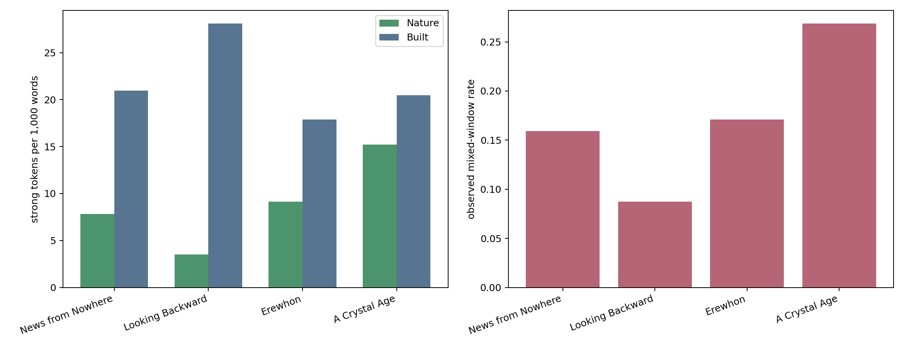
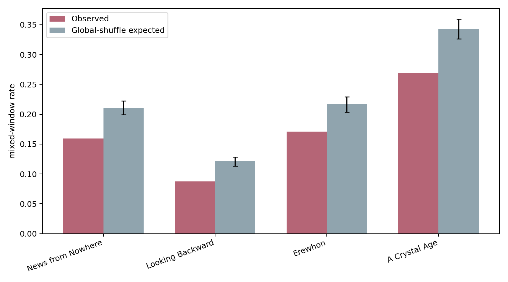

:::: {.section .screen .center .title-slide}
::: kicker
10-minute research talk
:::

# Bennett (2026) のMorris読解を計量的に検証する

::: lead
「再野生化されたThames」と自然―建造環境の局所的な共存
:::

::: {.title-axis aria-label="Nature to Built axis"}
river · tree · meadow

house · street · building
:::

::: byline
*News from Nowhere* を、同時代のユートピア文学3作品と比較する 
Stage 2 quantitative analysis + close reading
:::
::::

:::: {.section .screen}
::: kicker
1 — Starting point: Bennett (2026)
:::

## 「rewilded Britain」という読解は、本文分布にも現れるか？

::: {.paper-card .paper-card-wide}

GREEN LETTERS · 20 SEP 2026

<h3>Wild Belongings</h3>

Stories of Rewilding in William Morris’s <i>News from Nowhere</i> and Diane Setterfield’s <i>Once Upon a River</i>

Phillippa Bennett

<a href="https://doi.org/10.1080/14688417.2026.2733353">doi:10.1080/14688417.2026.2733353</a>
:::

::: {.three-col .claim-grid}
::: panel
**Thamesのagency**

川は人間の背景ではなく、自律的な存在として回復する。
:::

::: panel
**都市と田園の接続**

Londonは森・草地・果樹・川によって再編される。
:::

::: panel
**土地に応答する建築**

家や橋は自然と対立せず、土地から育つように構想される。
:::
:::

::: quote
**検証課題**　この読解は、自然語と建造環境語の局所的共存として測れるか。またMorrisに固有なのか。
:::
::::

:::: {.section .screen}
::: kicker
2 — Literary corpus
:::

## 4作品の文学史的位置づけ

::: lead
同時代に「よりよい社会」を描きながら、産業・都市・自然への態度が異なる4作品を選ぶ。
:::

::: {.two-col .corpus-grid}
::: {.panel .work-card .morris-card}
**William Morris, *News from Nowhere*** 1890 / 1891

革命後の未来イングランドをThamesの旅として描く社会主義的・田園的ユートピア。Bennettの検証対象。
:::

::: {.panel .work-card}
**Edward Bellamy, *Looking Backward*** 1888

西暦2000年のBostonを、中央集権的な産業組織と都市制度によって描く技術・制度中心の対照作。
:::

::: {.panel .work-card}
**Samuel Butler, *Erewhon*** 1872

機械・病気・制度を反転して批判する風刺的ユートピア／ディストピア。産業文明への両義性を担う。
:::

::: {.panel .work-card}
**W. H. Hudson, *A Crystal Age*** 1887 / 1919 rev.

遠未来の共同体を田園、家、装飾、家族秩序から描く牧歌的ロマンス。自然密度の高い比較作。
:::
:::

::: note
同一ジャンルの均質な標本ではなく、後期ヴィクトリア朝ユートピアの「自然―産業」スペクトラムをつくる小規模な比較コーパスである。
:::
::::

:::: {.section .screen}
::: kicker
3 — Operationalization
:::

## Bennettの質的主張をNature–Built mixingへ翻訳する

::::: axis
::: {.panel .nature-panel}
**Nature pole**

river / tree / meadow / flower / mist
:::

::: arrow
×
:::

::: {.panel .built-panel}
**Built pole**

house / street / wall / building / window
:::
:::::

::: {.three-col .method-grid}
::: panel
**① 意味軸を凍結**

GloVe embeddingから軸を作り、strong語彙をStage 1で固定。
:::

::: panel
**② 50語の局所窓**

step 25、章境界を保持。両極のstrong語があればmixed。
:::

::: panel
**③ 二段階で検証**

4作品の全体比較 → Bennettが挙げる13場面の直接照合。
:::
:::

::: note
作品比較は「Morrisに固有か」を、13場面照合は「Bennettの具体例を拾えるか」を問う。
:::
::::

:::: {.section .screen}
::: kicker
4 — Corpus-level test
:::

## Morrisは比較コーパスで最多ではなかった

::: lead
*News from Nowhere* が自然と建造環境を最も多く共存させる、という強い予測は支持されない。
:::

::: {.result-strip}
<b>0.269</b><small>A Crystal Age</small>
<b>0.171</b><small>Erewhon</small>
<b>0.159</b><small>News from Nowhere</small>
<b>0.087</b><small>Looking Backward</small>
:::
::::

:::: {.section .screen}
::: kicker
5 — Null model
:::

## 4作品とも、ランダム配置より両極を分けて置く

::: {.two-col .takeaway-grid}
::: panel
**global shuffle比**

Morrisは **0.756**。どの作品も1を下回り、Nature/Built語はランダムより凝集・分離する。
:::

::: panel
**段落内shuffle比**

Morrisは **0.927**。分離の多くは、両極が別段落へ配分されることから生じる。
:::
:::

::: {.verdict}
Bennettの読解は、作品全体の単純な「混合量」ではなく、特定場面の構成として検証すべきである。
:::
::::

:::: {.section .screen}
::: kicker
6 — News from Nowhere: local evidence
:::

## Bennettの論点に対応するmixed場面は、局所的には強い

::: {.three-col .evidence-grid}
::: {.panel .excerpt-card}
**産業の荒廃** 
第10章 / rank 1

“manufacturing districts … Houses … trees were cut down … building”

`tree` × `manufacturing · house · building`
:::

::: {.panel .excerpt-card}
**開かれた古い家** 
第31章 / rank 2

“river … meadow … house … door and windows … flowers”

`river · meadow · flower` × `house · door · window`
:::

::: {.panel .excerpt-card}
**都市のMuseum** 
第8章 / rank 7

“railings were gone … boughs of the trees … pigeons … building”

`tree` × `building`
:::
:::

::: {.verdict}
Morrisの特徴は全体量ではなく、London・建築・産業を自然との関係から作り直す場面にある。
:::
::::

:::: {.section .screen}
::: kicker
7 — Comparative counterexample
:::

## *A Crystal Age* は別の仕方で、より頻繁に両極を結ぶ

::: {.two-col .evidence-grid}
::: {.panel .excerpt-card .nature-panel}
**自然が家の内部に響く** 
第5章 / mixed rank 4

> “the ocean’s voice is in their rooms … salt spray … low tide … the whitewinged bird”

`tide · sea · bird` × `roof · room · floor`
:::

::: {.panel .excerpt-card .built-panel}
**自然形態が素材へ固定される** 
第14章 / mixed rank 7

> “The only flowers in the house … wrought in metal and carved in wood”

`flower` × `house · metal`
:::
:::

::: note
Morrisのrewildingが都市・社会の変容を語るのに対し、Hudsonでは自然と室内・装飾の接続が反復される。mixing率だけでは両者の文学的機能は区別できない。
:::
::::

:::: {.section .screen}
::: kicker
8 — Direct validation of Bennett's examples
:::

## Bennettの13場面を照合すると、9件は実質的に拾える

::: {.metric-grid}
::: {.metric .good}
<b>9</b>
実質的ヒット
<small>橋・道路・家・都市の森など</small>
:::

::: {.metric .weak}
<b>1</b>
弱い／曖昧
<small>tree × space</small>
:::

::: {.metric .bad}
<b>2</b>
形式的誤検出
<small>power / morning / night</small>
:::

::: {.metric .miss}
<b>1</b>
未検出
<small>town–countryの関係概念</small>
:::
:::

::: {.audit-line}
binary mixed<b>12 / 13</b>→ 語義を人手監査<b>9 + 1</b>有効候補
:::

::: {.note .warn}
「12/13を検出」だけなら過大評価になる。static embeddingの多義語を除くと、明確な支持は9件である。
:::
::::

:::: {.section .screen}
::: kicker
9 — Diagnostic cases
:::

## 橋は拾えた。町と田舎の関係は落ちた。

::: {.two-col .contrast-grid}
::: {.panel .caught}
**✓ 捕捉：Hammersmith Bridge**

Bennett論文頁5の「澄んだThames・鮭・工場の消失・新しい橋」。

Stage 2 rank 12： 
`river` × `building · booth · shop`

上位20と直接重なる論文事例はこの1クラスター。
:::

::: {.panel .missed}
**△ 未捕捉：town ↔ country**

論文頁6の「町と田舎が相互に影響し、差が小さくなる」。

10 overlapping windows中 **mixed = 0**

物体語ではなく、関係と変化を表す概念だからである。
:::
:::

::: quote
**次の改善**　場所語・関係表現の辞書、または文脈埋め込みを加え、語義監査済みの結果と比較する。
:::
::::

:::: {.section .screen .center .closing-slide}
::: kicker
10 — Answer to Bennett
:::

## 計量分析はBennettを「限定つきで」支持する

::: {.closing-points}

<b>1</b><strong>支持：</strong>論文の13場面中9件で、自然と建造環境の実質的な局所共存を確認した。

<b>2</b><strong>限定：</strong>Morrisは比較コーパスで最多ではなく、rewildingの特徴は作品全体量より場面の機能にある。

<b>3</b><strong>課題：</strong>town–countryのような関係概念と、static embeddingの多義語を別の方法で扱う必要がある。

:::

::: {.verdict .final-verdict}
Bennettのclose readingを置き換えるのではなく、どの主張が分布として再現し、どこから解釈が必要かを可視化する。
:::
::::

:::: {.section .flow .appendix}
::: kicker
Appendix — Sources & reproducibility
:::

## Sources

- Bennett, Phillippa. “Wild Belongings: Stories of Rewilding in William Morris’s *News from Nowhere* and Diane Setterfield’s *Once Upon a River*.” *Green Letters*, 2026. <https://doi.org/10.1080/14688417.2026.2733353>
- Morris, William. *News from Nowhere*. Reeves & Turner, 1891.
- Hudson, W. H. *A Crystal Age*. Duckworth, 1919 revised edition.
- Bellamy, Edward. *Looking Backward: 2000–1887*. Ticknor, 1888.
- Butler, Samuel. *Erewhon*. Trübner, 1872.

## Repository artifacts

- `slides.md`: editable source of truth
- `index.html`: generated presentation
- `data/work_summary.csv`: work-level results
- `data/permutation_summary.csv`: null-model results
- `data/bennett_2026_nfn_alignment.csv`: 13-case external alignment

::: note
Main window: 50 tokens / step 25. Global and paragraph-preserving permutations: 1,000 each. The primary frozen axis was not retuned after observing Stage 2 results.
:::
::::
